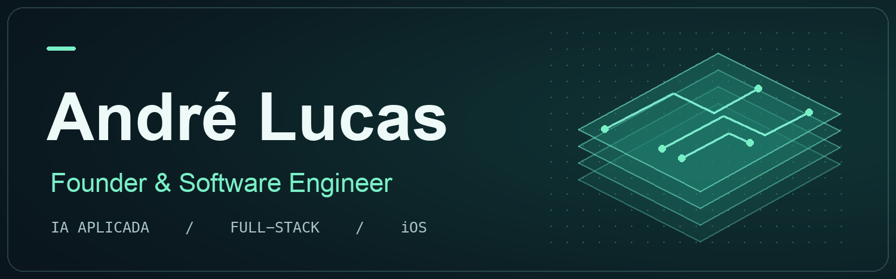
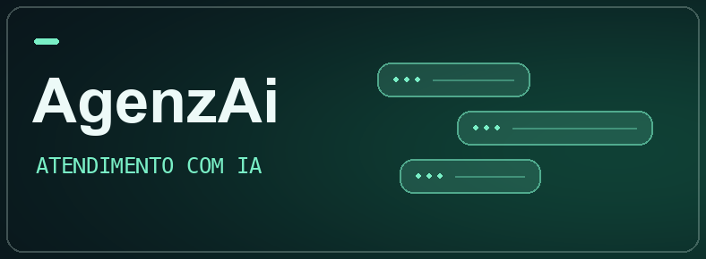
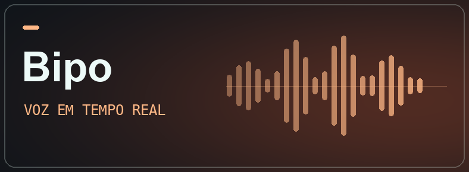

Construo produtos de software, da primeira versão à operação em produção. Meu trabalho passa por agentes de IA, apps iOS e plataformas que chegaram a centenas de milhares de usuários.

[LinkedIn](https://www.linkedin.com/in/andrezaolucas/)

## Produtos que construí

<table>
<tr>
<td width="50%" valign="top">

Plataforma de IA para equipes políticas atenderem eleitores em escala, acompanharem demandas e analisarem o sentimento nas conversas.

<a href="https://agenzai.io/">Visitar AgenzAi ↗</a>

</td>
<td width="50%" valign="top">

App iOS de voz instantânea entre amigos, com comunicação em tempo real no estilo push-to-talk.

<a href="https://bipo.chat/">Visitar Bipo ↗</a>

</td>
</tr>
</table>

- **Privify · 250 mil usuários.** Cofundei e desenvolvi uma plataforma de monetização para criadores.
- **Givaways · mais de 300 mil usuários.** Fundei e liderei um produto de sorteios para Instagram.
- **[AndreClaw](https://github.com/andrezaolucas/andreclaw).** Assistente de IA open source para terminal, com suporte a modelos locais e integração com GitHub Actions.

## Stack

| Área | Tecnologias |
| --- | --- |
| **IA aplicada** | Agentes de IA, LLMs, RAG e automação de workflows |
| **Web e mobile** | TypeScript, React, Next.js, Node.js, Python, SwiftUI |
| **Dados e infraestrutura** | PostgreSQL, Redis, Docker, Linux, AWS, CI/CD e alta disponibilidade |
| **Segurança** | Segurança de aplicações web e APIs |
